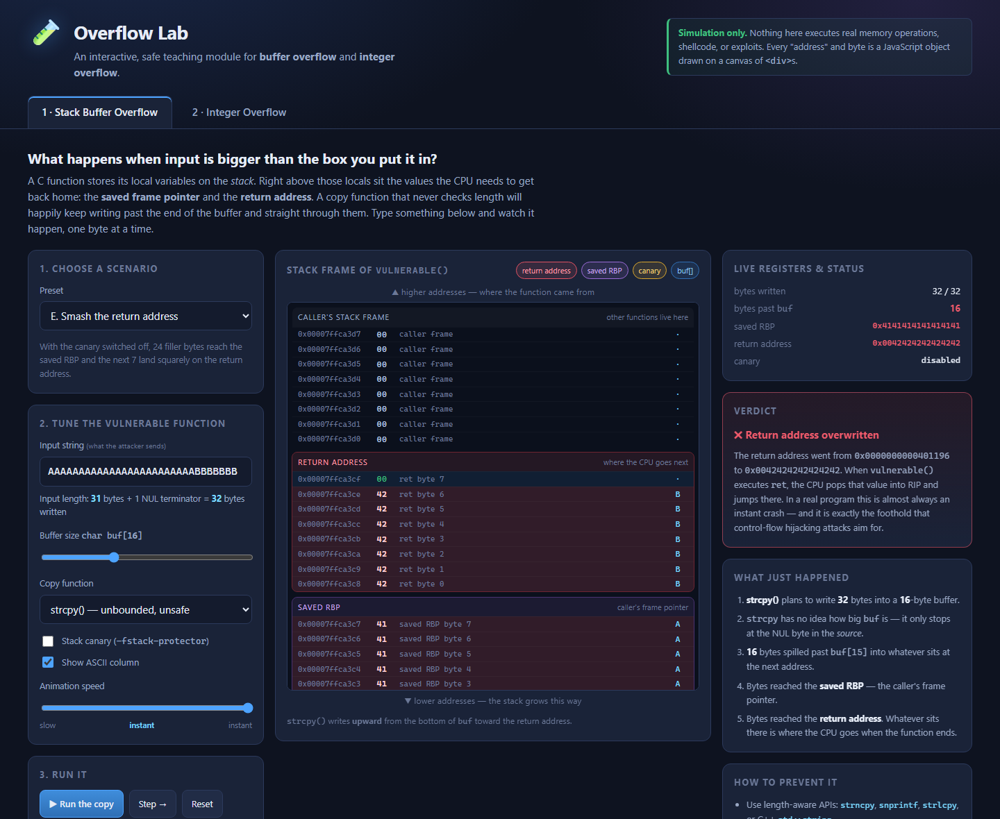

# 🧪 Overflow Lab

**An interactive, browser-based teaching module for buffer overflow and integer overflow.**

Overflow Lab turns two of the most confusing topics in a systems-security class into something you can
*poke at*. Type a string, watch it march past the end of a buffer and overwrite the saved frame pointer and
return address, one byte at a time. Or slide a number past `INT_MAX` and watch the bits that do not fit get
thrown on the floor.

Everything is a simulation. There is no shellcode, no exploit, and no real memory access anywhere in this
repository — every "address" and every byte is a plain JavaScript value rendered into `<div>` elements.

---

## Run it

No build step, no dependencies, no network access required.

**Option 1 — just open the file**

```
git clone https://github.com/Jase35/Learning-Sprint-2.1.git
cd Learning-Sprint-2.1
```

Then double-click `index.html`, or open it in any modern browser.

**Option 2 — serve it locally** (recommended if you want to share it on a LAN)

```bash
python -m http.server 8000
# then browse to http://localhost:8000
```

**Option 3 — GitHub Pages**

Enable Pages for this repository (Settings → Pages → Deploy from branch → `main` / root) and the app is live
at `https://jase35.github.io/Learning-Sprint-2.1/`.

Requires any browser with `BigInt` support — Chrome/Edge 67+, Firefox 68+, Safari 14+.

---

## Lesson 1 — Stack buffer overflow



A simulated 64-bit stack frame for this function:

```c
void vulnerable(const char *src)
{
    char buf[16];
    strcpy(buf, src);     // no length check anywhere
    use(buf);
}
```

The frame is drawn one byte per row, highest address at the top, exactly the way the stack is usually
diagrammed in class:

| region | why it is there |
| --- | --- |
| caller's stack frame | what lies beyond this function |
| **return address** (8 B) | where the CPU jumps when `vulnerable()` finishes |
| **saved RBP** (8 B) | the caller's frame pointer, restored on the way out |
| **stack canary** (8 B) | a tripwire the compiler inserts with `-fstack-protector` |
| **`buf[N]`** | the local buffer the string is copied into |

### What you can change

- **Input string** — anything you type is copied byte by byte into `buf`.
- **Buffer size** — 8, 16, 24 or 32 bytes.
- **Copy function** — `strcpy()` (unbounded), a `for (i = 0; i <= n; i++)` loop (off-by-one), or a correct
  bounded `strncpy()`.
- **Stack canary** — on or off, so you can compare a *detected* crash with a silent hijack.
- **Animation speed** — from one byte per 600 ms down to instant.
- **Run / Step / Reset** — `Step` writes exactly one byte, which is the best way to catch the precise moment
  the buffer boundary is crossed.

### The six built-in scenarios

| | Scenario | What it teaches |
| --- | --- | --- |
| A | Input fits | The baseline: all bytes stay inside `buf`. |
| B | Exact fit | 16 characters in a 16-byte buffer still writes 17 bytes, because `strcpy` copies the NUL terminator too. |
| C | Off-by-one | `i <= n` instead of `i < n`. One stray byte is a security bug. |
| D | Overwrite the canary | The overflow is caught: `*** stack smashing detected ***` and the process aborts. |
| E | Smash the return address | With the canary off, 24 filler bytes reach the saved RBP and the next 7 land on the return address, which becomes `0x0042424242424242`. |
| F | Custom | Type your own and watch the "bytes past `buf`" counter. |

### Details worth noticing

- The canary's **lowest byte is `0x00` on purpose** — that is how glibc's *terminator canary* works, so
  `str*()` functions cannot copy a valid canary forward. A consequence the app demonstrates directly:
  a single NUL-byte overflow writes `0x00` over a byte that was already `0x00`, so the canary survives
  and the overflow goes **undetected**. Scenario B shows exactly this.
- The canary sits *below* the saved RBP and the return address, so it is always corrupted first. That
  ordering is why a detected overflow becomes a crash rather than a hijack.
- The verdict panel distinguishes four outcomes: safe, silent overflow, canary tripped, and
  return-address / frame-pointer corruption.

---

## Lesson 2 — Integer and arithmetic overflow


Pick a width (**8 / 16 / 32 / 64-bit**) and a signedness, then work through four scenarios.

### A — Explore

Choose two operands and an operator (`+`, `-`, `*`, `<<`) and compare:

- the **true mathematical result**, computed exactly with `BigInt`;
- the value the fixed-width type **actually stores**;
- which bits were **discarded**, and whether anything was discarded at all;
- the same bit pattern **read with the other signedness**.

Two visualisations make the truncation concrete:

- **Bit view** — every row is drawn with the same number of columns so the bits line up. Dashed columns are
  outside the type; red columns are bits the arithmetic produced and the type threw away.
- **Wrap-around dial** — the value space drawn as a circle, with the overflow seam marked in red. For an
  unsigned type the seam is at `0 ⇄ UMAX`; for a signed type it is at `MAX ⇄ MIN`. Adding past the top edge
  does not keep climbing, it comes back around.

The app is careful about a distinction that trips people up: `INT_MAX + 1` discards **no bits at all** — the
top bit is simply reinterpreted as the sign bit. `255u + 1` in a `uint8_t` really does throw a bit away.
The readout says which one happened.

### B — Odometer

A counter in a loop. Set a step size, jump to just below the maximum, then tick or auto-count over the edge.
Shows the wrap count, the distance remaining before overflow, and the bit pattern before and after.
Signed wraparound is flagged as **undefined behaviour** — the reason `if (counter + 1 < counter)` can be
optimised out of existence.

### C — Allocation overflow

```c
uint32_t count = /* from the network */;
Item *items = malloc(count * sizeof(Item));
for (uint32_t i = 0; i < count; i++)
    items[i] = read_item();
```

Slide `count` into the danger zone and watch `count * sizeof(Item)` wrap. With a 32-bit `size_t` and
`sizeof(Item) == 16`, a count of `268435457` asks for 4 GiB, `malloc` is handed **16 bytes**, the allocation
succeeds, and the loop then writes 4 GiB past the end of the chunk. A heap strip shows the allocated chunk
against the spill.

### D — Signed/unsigned confusion

```c
if (len > MAX) return;          /* signed comparison */
memcpy(dst, src, len);          /* len converts to size_t */
```

Pass `len = -1` and follow the step-by-step trace: the signed comparison says "small", `memcpy` converts the
same bits to `size_t`, and the length becomes 16 EiB. The bit strip shows one bit pattern read three ways —
as `int32_t`, as `uint32_t`, and widened to a 64-bit `size_t`.

---

## Deep links

Any state worth showing a class can be put in a URL fragment, so you can bookmark a scenario or paste it
into slides:

```
index.html#lesson=1&preset=smash&run=1
index.html#lesson=1&input=AAAAAAAAAAAAAAAAA&buf=16&fn=loop&canary=1
index.html#lesson=2&scenario=alloc&width=32
index.html#lesson=2&scenario=explore&width=64&sign=unsigned&a=4000000000&b=9&op=*
```

| key | values |
| --- | --- |
| `lesson` | `1`, `2` |
| `preset` | `safe`, `exact`, `offbyone`, `canary`, `smash` |
| `input` | the attacker string (up to 48 characters) |
| `buf` | `8`, `16`, `24`, `32` |
| `fn` | `strcpy`, `loop`, `strncpy` |
| `canary` | `0`, `1` |
| `run` | `1` to run the copy immediately |
| `scenario` | `explore`, `odometer`, `alloc`, `signed` |
| `width` | `8`, `16`, `32`, `64` |
| `sign` | `signed`, `unsigned` |
| `a`, `b`, `op` | operands (decimal or `0x…`) and `+`, `-`, `*`, `<<` |

## Project layout

```
index.html        markup for both lessons
css/styles.css    all styling; no frameworks
docs/             README screenshots
js/util.js        DOM helpers, formatting, fixed-width BigInt arithmetic, bit-strip renderer, deep-link parsing
js/stack.js       lesson 1 — frame model, write simulation, verdict analysis
js/integer.js     lesson 2 — four scenarios, bit view, SVG wrap-around dial
js/app.js         tab switching, deep-link dispatch, bootstrap
```

The simulation core is deliberately small and readable:

- `js/stack.js` models the frame as a flat array of byte values plus a list of labelled regions. A copy
  function is compiled into a **write plan** (`[{off, value}, …]`), and the verdict is derived by comparing
  the current bytes against the pristine ones — which is why a NUL written over an already-NUL canary byte
  is correctly reported as *undetected*.
- `js/integer.js` does every calculation with `BigInt`, then truncates with an explicit
  `wrap(value, bits, signed)`. Nothing relies on JavaScript's own number semantics, so 64-bit results are
  exact.

## Classroom use

Suggested 15-minute sequence:

1. Lesson 1, scenario A — establish what "normal" looks like.
2. Scenario B — ask the class to predict whether 16 characters fit in `char buf[16]`. They usually say yes.
3. Scenario C with **Step** — advance one byte at a time and pause on the boundary crossing.
4. Scenario D vs. E — toggle the canary off and on to contrast a detected crash with a hijacked return address.
5. Lesson 2, scenario C — connect the two lessons: an integer bug *causes* a memory-safety bug.

## Safety and scope

This is a teaching tool, not an offensive one.

- No shellcode, no ROP chains, no exploitation techniques, no real addresses.
- Nothing is executed, allocated, or copied outside of ordinary DOM updates.
- No network requests, no analytics, no third-party scripts, no cookies or storage.

## Credits

Concepts inspired by educational projects such as [BOMOD](https://github.com/benjholla/bomod), an
instructional buffer-overflow module. This implementation is original, written from scratch in plain
HTML, CSS and JavaScript.

## License

[MIT](LICENSE)
